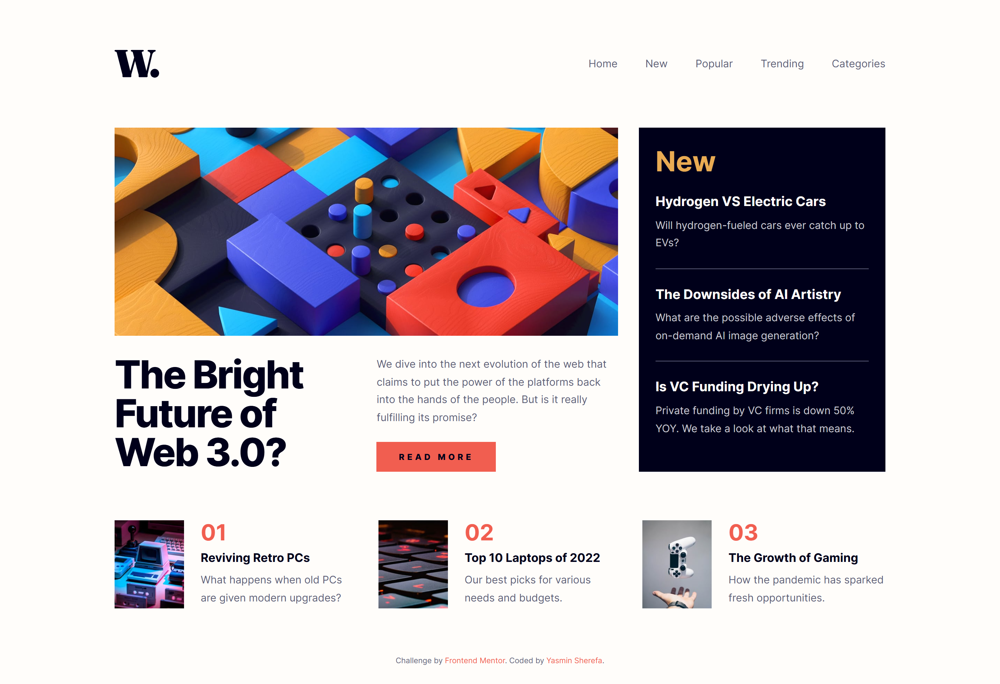
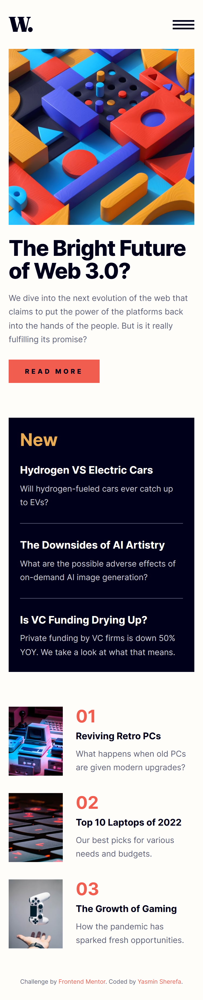

# News Homepage

My solution to the News homepage challenge on [Frontend Mentor](https://www.frontendmentor.io/challenges/news-homepage-H6SWTa1MFl).

## Screenshots

| **Desktop** | **Mobile** |
| --- | --- |
|  |  |

## Overview

The goal of this challenge was to build a responsive news homepage that closely matches the provided desktop and mobile designs. The page features a main article, a sidebar displaying the latest news, and three additional popular stories.

Visitors can navigate the homepage on different screen sizes and interact with the navigation menu.

## Built with

- Semantic HTML5
- CSS custom properties
- CSS Grid
- Flexbox
- Vanilla JavaScript
- Responsive design with CSS media queries
- Mobile-first considerations

## How I built it

I started by organizing the page with semantic HTML elements, including `header`, `nav`, `main`, `section`, `article`, `aside`, and `footer`.

I used CSS Grid to create the main desktop layout, placing the featured article beside the New articles panel. I also used Grid to arrange the three popular stories. Flexbox helped align the navigation and featured article content.

For smaller screens, I used media queries to rearrange the content into a single-column layout and implemented a mobile navigation menu using JavaScript. The menu can be opened and closed using its controls, the overlay, or the Escape key.

I also added hover and keyboard-focus states to interactive elements to make navigation clearer and more accessible.

## What I learned

- How to use CSS Grid to create a multi-column editorial layout.
- How to reorganize a desktop layout for mobile screens using media queries.
- How to build an interactive mobile navigation menu with vanilla JavaScript.
- Why semantic HTML and accessible navigation controls matter.
- How to use `:focus-visible` alongside hover states for keyboard accessibility.

## Continued development

I want to keep improving my CSS Grid skills, pay closer attention to responsive spacing and typography, and practise making interactive interfaces more accessible.

## Run it locally

1. Clone or download this repository.
2. Open the project folder in VS Code.
3. Open `index.html` in your browser or use the Live Server extension.

No build tools or frameworks are required.

## Author

Yasmin Sherefa